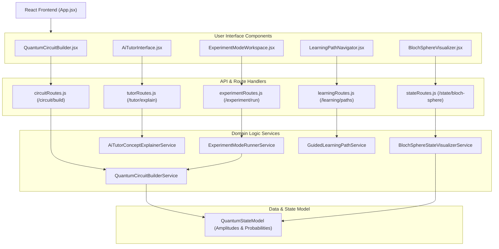

# Architecture & Technical Design Notes

## Overview
The **Quantum Computing Learning Simulator** is structured using a clean 4-tier modular architecture:
1. **User Interface Tier**: React components located in `src/components/`, enabling interactive quantum circuit editing, SVG Bloch sphere rendering, AI tutor interaction, experiment execution, and learning path navigation.
2. **API & Routing Tier**: RESTful endpoints defined in `src/routes/` and served via `src/server.js`, handling request validation and payload dispatching.
3. **Domain Business Logic Tier**: Pure services in `src/services/` performing mathematical quantum state transformations, linear algebra operations (matrix-vector multiplication, Kronecker tensor products), Bloch sphere spherical angle calculation, and Monte Carlo sampling.
4. **Data & State Modeling Tier**: Models in `src/models/` defining state representations, probability calculations, and system schemas.

## Component Architecture Flow

## Security & Reliability Hardening
- **Zero Secrets**: All configurations are environment-parameterized with `.env.example`. No keys or tokens are stored in source.
- **Input Validation Boundaries**: Every endpoint validates input types (qubit count, gate array structure, questions, and shots bounds) in `src/utils/validator.js`.
- **Zero Dangerous Sinks**: No dynamic `eval()` or unparameterized command injection patterns are used.
- **Robust Error Handling**: Explicit `try ... catch (err)` blocks log diagnostics and return structured JSON error responses.
